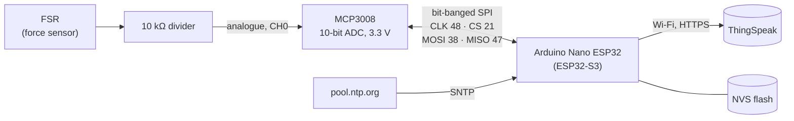
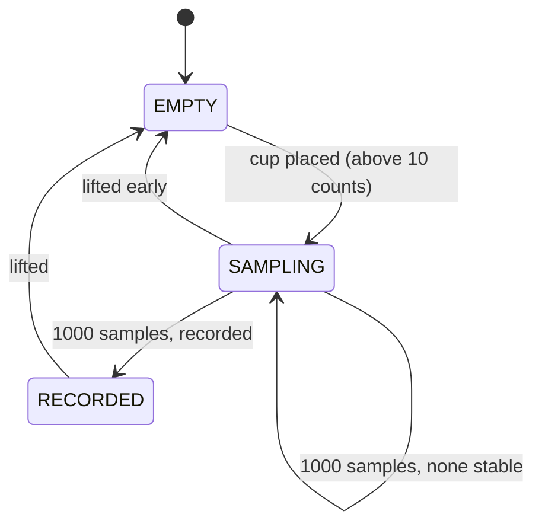
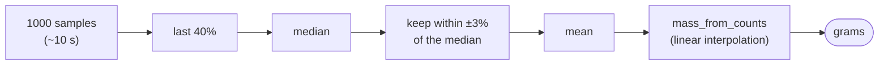
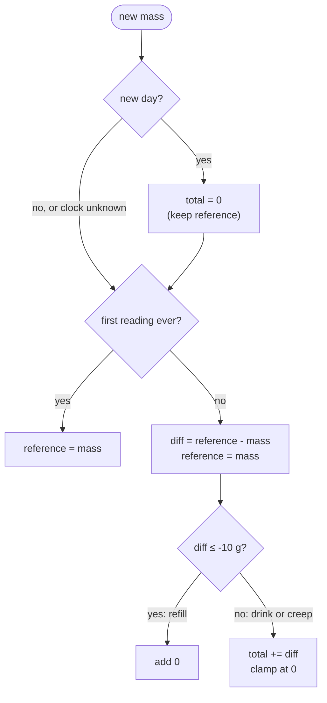
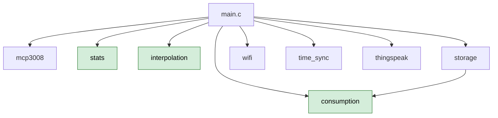

# c-coaster

A smart coaster that tracks how much you drink. It's [SmartCoaster](https://github.com/sabrina553/SmartCoaster) (Raspberry Pi + Python) rewritten in embedded C for an Arduino Nano ESP32 (ESP32-S3) with ESP-IDF. This is my first real C project.

## What it does
- Takes **one reading per placement**. When a cup is put down, it samples the force sensor for about 10 s, keeps the stable readings, and converts them to grams. It then waits for the cup to be lifted.
- **Tracks the daily total.** A lighter cup counts as drinking. A gain of 10 g or more is a refill. Smaller gains are sensor creep and cancel out. The total resets at UK midnight.
- **Survives reboots**, by keeping the day's state in NVS (flash).
- **Posts each reading to ThingSpeak** over HTTPS (field1 = ADC counts, field2 = mass in g, field3 = daily total in g). Sending runs in its own FreeRTOS task, so a slow network never stalls sampling.

## Hardware
FSR + 10 kΩ divider into an MCP3008 (powered at **3.3 V**, the ESP32 is not 5 V tolerant), bit-banged SPI; six status LEDs (not wired up in this version yet).

## How it works

### Hardware


### Coaster states
One reading per placement: sample until a stable mass is recorded, then wait for a lift.


### From samples to grams


### Consumption rule

Small gains subtract on purpose, so sensor creep cancels out over time.

### One placement, end to end
```mermaid
sequenceDiagram
    participant Cup
    participant Loop as Sampling loop
    participant Cons as consumption
    participant NVS as storage (NVS)
    participant Q as Queue
    participant Net as Network task
    participant TS as ThingSpeak

    Cup->>Loop: placed
    loop every 10 ms, 1000 times
        Loop->>Loop: mcp3008_read(0)
    end
    Loop->>Loop: stable_counts, mean, mass
    Loop->>Cons: consumption_update(mass, day)
    Loop->>NVS: storage_save
    Loop->>Q: xQueueSend(reading)
    Q->>Net: xQueueReceive
    Net->>TS: HTTPS POST /update
    TS-->>Net: 200
    Net->>Net: wait 15 s (rate limit)
    Cup->>Loop: lifted
```

### Modules
The highlighted modules have no hardware dependencies and are unit-tested on the host.


## Code layout
| File | Purpose |
|---|---|
| `main/main.c` | State machine (empty, sampling, recorded) and the network task |
| `main/mcp3008.c` | Bit-banged SPI driver for the ADC |
| `main/stats.c` | Median, mean and stable-reading filter |
| `main/interpolation.c` | ADC counts to grams (calibration table) |
| `main/consumption.c` | Daily total logic |
| `main/storage.c` | NVS persistence |
| `main/wifi.c`, `time_sync.c`, `thingspeak.c` | Wi-Fi, SNTP (UK time), ThingSpeak client |
| `test/` | Host-side unit tests |

## Setup
Credentials live in a git-ignored file, layered over `sdkconfig.defaults` at build time:
```zsh
cp sdkconfig.secrets.example sdkconfig.secrets   # fill in Wi-Fi and the ThingSpeak Write API key
rm -f sdkconfig                                   # regenerate so the new values are picked up
```

## Build and flash
```zsh
idf                       # alias: loads ESP-IDF into the shell
idf.py set-target esp32s3 # once
idf.py build
idf.py -p /dev/ttyACM0 flash monitor   # Ctrl+] quits the monitor
```

## Tests
The hardware-free modules (`stats`, `interpolation`, `consumption`) are tested on the PC with plain `gcc`, AddressSanitizer and UBSan:
```zsh
make -C test
```

## What I learnt
- **Serial port access:** `/dev/ttyACM0` needs the `dialout` group (`sudo usermod -aG dialout "${USER}"`, then log in again).
- **Download mode:** B1 (GPIO0) is a strapping pin. If it's low at reset, the chip stays in the ROM bootloader ("waiting for download"). Only jumper it to GND when a flash can't connect.
- **USB reconnects:** the S3's USB is on-chip, so every reset briefly disconnects the monitor. That's expected.
- **`vTaskDelay`, not busy loops:** yielding keeps the FreeRTOS task watchdog happy.
- **Headers are interfaces:** keep pin definitions and helpers private to the `.c` file, and include what you use.
- **Test logic on the host:** the first host build found two bugs that the ESP-IDF build never warned about.

## What I would do better
- Retry failed ThingSpeak sends instead of dropping them.
- Use the ESP32's hardware SPI peripheral instead of bit-banging.
- Wire up the LEDs: goal progress and a drink reminder.
